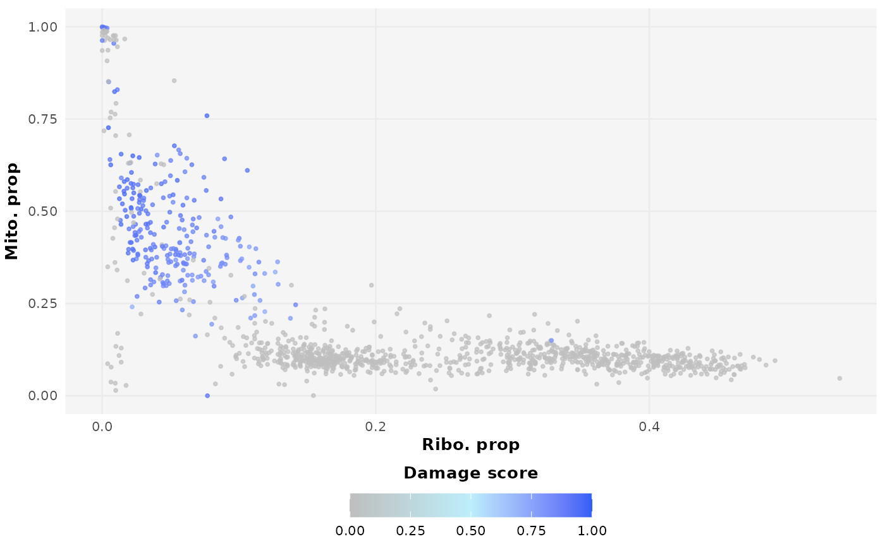

# Damage cell quality control

## Tutorial overview

The goal of `DamageDetective` is to simplify the process of making
informed and reproducible damaged cell filtering decisions. This
tutorial provides an outline of the steps needed to achieve this:

- Data preparation

- Parameter selection

- Damaged cell detection

Ensure the following packages are installed and made available in your R
environment to follow along:

- `DamageDetective`, `ggplot2`, `Seurat`, `SeuratData`, `scRNAseq`,
  `SingleCellExperiment`, and `patchwork`.

  

## Workflow overview

The `DamageDetective` workflow is made up of three stages, first,
clustering the cells and performing a quality check at this level,
second, creating artificial profiles of damage using the cells of
clusters that have passed the initial quality check, and third,
comparing the input cells to the artificial profiles.

This approach is inspired by `DoubletFinder`—a high-performing tool for
filtering doublets, another prominent scRNA-seq artifact. Here,
artificial profiles of doublets are created through the random
combination of existing cells. All cells are processed before being
compared in a principal component analysis (PCA) from which proximity
measures are taken and used to determine the proportion of a true cell’s
neighbours that are of artificial origin (proportion of artificial
nearest neighbours, or pANN). Cells that show the highest pANN, i.e.,
have the highest proximity to artificial profiles, are ultimately
labelled as doublets in accordance to anticipated doublet formation
rate.

In `DamageDetective`, a score is similarly calculated for each cell
based on PCA comparisons where scores closer to one indicate a greater
proximity to artificially profiles and a higher likelihood of damage.
This score is used to filter cells, either automatically using the
default threshold or manually according to a user-defined threshold.

*How* these scores are calculated and *what exactly* they describe will
be explored briefly before heading into the demonstrations.

#### Creating artificial damage

The loss of plasma membrane integrity is a characteristic of cellular
damage that has long since been exploited to assess cell viability.
Compromised membranes allow cellular content, including RNA, to escape,
leading to a reduction in library size and complexity.

An additional and fundamental consequence of membrane integrity loss is
a shift in library composition. This occurs because not all RNA within a
cell is equally vulnerable to loss. RNA enclosed by additional
membranes, such as within mitochondria or nuclear speckles, is more
protected than RNA freely present in the cytoplasm. As a result, viable
cells have a higher proportion of cytoplasmic RNA, whereas damaged
cells—where RNA has escaped—appear to have an elevated proportion of
protected RNA. This forms the basis for simulating damage in
`DamageDetective`.

Artificial damage profiles are generated by simulating the loss of
cytoplasmic RNA to reflect varying levels of cellular damage. Each
artificial cell is assigned a target damage level between 0 and 1, drawn
from a normal distribution centered between 0.65 and 1. This range is
based on the assumption that losing at least 65 % of cytoplasmic RNA
represents a substantial level of damage warranting exclusion from
downstream analysis. To simulate this, transcripts are sampled from each
cell without replacement, according to gene abundance within the cell,
until the desired proportion of RNA loss is achieved.

Simulations are grouped by cluster from the input data to generate cell
type–specific profiles of damage. The goal is to create a pool of
artificially damaged cells that reflects all cell types present in a
heterogeneous sample. Depending on the target damage level, these
artificial cells retain some of the original gene expression signatures
of their cell type while exhibiting features typical of damage—such as
reduced complexity, smaller library sizes, and increased mitochondrial
RNA—resulting from the simulated loss of cytoplasmic RNA. This provides
a realistic basis for comparison and, ultimately, a means of estimating
true damage.

#### Estimating true damage by comparison to artificial damage

`DamageDetective` estimates the damage level of true cells by measuring
their similarity to artificially damaged cells. Like `DoubletFinder`,
this measurement is rooted in PCA. However, instead of using full gene
expression values, it uses cell quality control (QC) metrics, including
library size, complexity, and mitochondrial RNA proportion—a
biologically informative and computationally efficient alternative.

Using Euclidean distances between the PCA embeddings of cells, a set of
$`k`$ nearest neighbours is identified for each cell via the HNSW
(Hierarchical Navigable Small World) algorithm. This is optimized for
high-dimensional data and implemented in R using C++ through the
`RcppHNSW` package.

The proportions of a cell’s nearest neighbours that originate from each
artificial profile (pANN) are calculated. In other words, if there are
five clusters in a dataset, there will be five sets of artificial
profiles and five pANN scores for each cell. After scaling according to
the size of each artificial profile, the maximum pANN is retrieved for
each cell. This score naturally lies between 0 and 1 and indicates the
similarity of true cells to damaged profiles.

The proximity score forms the main output of `DamageDetective` and can
be thought of as answering the question: on a scale of 0 to 1, how
likely is it that this cell has lost a considerable amount of
cytoplasmic RNA? Or, equivalently, how likely is it that this cell is
damaged and should be filtered?

  
  

## Data preparation

`DamageDetective` operates with single cell data in the form of a
compressed, column-oriented sparse matrix (`dgCMatrix`) in `R`. This
format efficiently handles the sparse nature of single cell data by
indexing only non-zero elements within each column, i.e., only the rows
containing actual expression values. We will begin by showing how three
common single cell data storage types can be converted to this form to
act as the starting point for damage detection.

These include,

1.  Alignment output files
2.  `Seurat` object
3.  `SingleCellExperiment` (`sce`) object

### Convert data to sparse matrix format

#### 1. Alignment output

Alignment output comes in the form of three files,

- `features.tsv`, containing the gene names  
- `barcodes.tsv`, containing the cell identifiers  
- `matrix.mtx`, containing the input values (gene expression values).

These can be compiled using `ReadMtx` offered by `Seurat` which
simplifies the count matrix compilation process into one function. This
includes the processes of decompressing zipped files, mapping feature
names to HGNC gene symbols, and converting the matrix to sparse format.
The `ReadMtx()` output can be used directly as input for
`DamageDetective`.

We will use publicly available alignment data from the 10X Genomics
website for demonstration, specifically the ‘1k PBMCs from a healthy
donor (v3)’ dataset, which can be downloaded
[here](https://www.10xgenomics.com/datasets/1-k-pbm-cs-from-a-healthy-donor-v-3-chemistry-3-standard-3-0-0)
following the link named “Feature / cell matrix (filtered)”. This should
begin the download of a 9.6 MB directory containing
‘filtered_feature_bc_matrix’ sub-directory housing the alignment files.

``` r

# Set the file paths relative to location on your device
matrix_file <- "~/Projects/filtered_feature_bc_matrix/matrix.mtx.gz"     
barcodes_file <- "~/Projects/filtered_feature_bc_matrix/barcodes.tsv.gz" 
features_file <- "~/Projects/filtered_feature_bc_matrix/features.tsv.gz" 

# Construct the sparse matrix
alignment_counts <- Seurat::ReadMtx(
  mtx = matrix_file,
  cells = barcodes_file,
  features = features_file
)
```

> Note: Please adjust the location, `~/Projects`, according to where the
> files are saved on your device.

#### 2. `Seurat` object

`Seurat` is one of the most popular packages for single cell analysis in
`R`. Along with an extensive suite of functions, it offers its own S4
class of data storage for housing the count matrix, aptly named the
`Seurat` object. By default, the count matrix is already in compressed
column-oriented sparse form in the `Seurat` object and can be used as
input for `DamageDetective` after it is extracted from the assay slot.

You can use the `SeuratData` package to retrieve a publicly available
`Seurat` object to test this. This object stores the data from
peripheral blood mononuclear cells (PBMCs) sequenced using the 10X
Genomics platform.

``` r

devtools::install_github('satijalab/seurat-data')
library(SeuratData)

# Retrieve the dataset of interest
SeuratData::InstallData("pbmc3k")
data("pbmc3k")

# Extract the count matrix
pbmc3k_counts <- pbmc3k[["RNA"]]$counts
```

#### 3. `sce` object

`Bioconductor` offers its own suite of packages for single cell analysis
in R with their own single cell data storage type known as the
`SingleCellExperiment` (`sce`) object. Here, the count matrix is stored
as a delayed matrix. This format enables memory-efficient operations by
*delaying* computations until explicitly requested, rather than storing
all values in memory upfront. However, `DamageDetective` computations
require repeated access to the matrix and delays at each request greatly
accumulate to slow down this process. We therefore convert the delayed
matrix to a sparse matrix via a dense matrix intermediate.

You can use the `scRNAseq` package to retrieve a publicly available
`sce` object to test this. This object stores PBMC data of multiple
samples from a study investigating influenza and yellow fever vaccine
responsiveness. We will focus on the “234_d0” sample coming from an
individual with a high vaccine responsiveness.

``` r

if (!require("BiocManager", quietly = TRUE))
    install.packages("BiocManager")
BiocManager::install("scRNAseq")
library(scRNAseq)

# Retrieve multisample dataset
pbmc_sce <- scRNAseq::fetchDataset("kotliarov-pbmc-2020", "2024-04-18")

# Extract sample of interest
metadata <- SummarizedExperiment::colData(pbmc_sce)
sample_sce <- subset(metadata, sample == "234_d0")
sample_sce <- rownames(sample_sce)

# Subset and convert to sparse format
pbmc_counts <- SummarizedExperiment::assay(pbmc_sce, "counts")
sample_counts  <- pbmc_counts[, sample_sce]
sample_counts <- as.matrix(sample_counts)
sample_counts <- as(sample_counts, "dgCMatrix")
```

> Note: Like many single cell analysis packages, DamageDetective can
> only operate with one single cell dataset at a time. Hence why we work
> with only the “234_d0” sample above.

## Parameter selection

Once the count matrix is in the correct format, the `detect_damage`
function of `DamageDetective` can be run immediately. However,
`detect_damage` accepts additional parameters. These parameters can be
divided into two categories, those that alter the computation and result
in a different output, **computational parameters**, and those that
adjust how the user receives the output but cannot change the output
itself, **aesthetic parameters**. Both will be explored briefly.

### Computational parameters

#### Dataset-defined computational parameters

Of the parameters that affect the output of the detection algorithm,
some have only one possible input based on the data being investigated.
In many cases, these require no alteration from the defaults. These
include,

| Parameter | Default | Description |
|----|----|----|
| `organism` | `"Hsap"` | Specifies the organism the data was derived from. Supports `"Hsap"` (human) and `"Mmus"` (mouse). |
| `annotated_celltypes` | `FALSE` | Indicates whether cell types are already annotated. If `TRUE`, ensures simulations are distributed evenly across known cell types. |

> To use a non-default organism, specify the strings used to identify
> mitochondrial and ribosomal genes, and optionally, a set of
> nuclear-enriched genes.  
> For example, the format for human data is:
>
> ``` r
>
> organism <- list(mito_pattern = "^MT-",
>                  ribo_pattern = "^(RPS|RPL)",
>                  nuclear = c("NEAT1", "XIST", "MALAT1"))
> ```

#### User-defined computational parameters

The remaining computational parameters have a wider range of input
possibilities. While the user is free to adjust these as they see fit,
we recommend using the defaults provided as they resulted in consistent
and intended performance during package development. This being said,
the `ribosome_penalty` parameter must be adjusted according to the input
data and is explored in more detail below.

| Parameter | Default | Description |
|----|----|----|
| `seed` | User-defined | Ensures reproducibility of the algorithm. While the seed affects random sampling, its impact is minimal unless using cells with unusually high expression and low sparsity. |
| `kN` | One third of the dataset size | Number of nearest neighbours considered when calculating the proportion of nearby damaged cells. Higher values increase chance of false detection due to unrelated artificial neighbours. |
| `target_damage` | `c(0.65, 1)` | Range of cytoplasmic RNA loss used to simulate damage. Higher values simulate more severely damaged cells, forming the basis of the comparison with true cells. |
| `pca_columns` | `c("log.features", "log.counts", "mt.prop", "rb.prop")` | Variables used for principal component analysis during damage detection. Includes traditional and novel quality control metrics and transformations. |
| `filter_threshold` | `0.5` | Score threshold (0 to 1) used to determine which cells are removed. Lower values enforce stricter filtering, while higher values are more permissive. |
| `ribosome_penalty` | 0.5 | Adjusts the likelihood of ribosomal RNA loss during simulation, correcting for observed discrepancies where ribosomal RNA is retained more than expected. |

##### Computing the ideal `ribosome_penalty`

`ribosome_penalty` is a value between 0 and 1 that is multiplied by the
probability scores of ribosomal RNA loss, reducing the scores and making
it less likely for the ribosomal transcripts to be sampled for loss.

The impact of changing `ribosome_penalty` can be explored using the
plots generated from `simulate_counts` below. The idea here is to see
how well the artificial cells generated with a selected penalty describe
the true cells. In other words, how well the coloured dots superimpose
the grey dots. You will see that as you increase the penalty, i.e. go
from values closer to 1 to values closer to 0, the coloured dots shift
from an extreme position on the left-hand side of the plot to a more
central position. At what point along this range true cells exist is
dataset-dependent but generally lies closer to 0. Where,

- `count_matrix` is the data in a sparse matrix format as prepared
  above,
- `ribosome_penalty` is a numeric between 0 and 1, and
- `damage_proportion` is a number between 0 and 1 specifying the amount
  of artificial cells to create relative to the input data (*setting
  this to a lower value makes the computation faster*).

  

``` r

no_penalty <- DamageDetective::simulate_counts(
  count_matrix = alignment_counts,
  ribosome_penalty = 1,  
  damage_proportion = 0.25,  
  target_damage = c(0.6, 1), 
  plot_ribosomal_penalty = TRUE,
  seed = 7
)

no_penalty_plot <- no_penalty$plot + ggtitle("No penalty") + 
  theme(plot.title = element_text(face = "bold", hjust = 0.5))

medium_penalty <- DamageDetective::simulate_counts(
  count_matrix = alignment_counts,
  ribosome_penalty = 0.2,  
  damage_proportion = 0.25,  
  target_damage = c(0.6, 1),
  plot_ribosomal_penalty = TRUE,
  seed = 7
)

med_penalty_plot <- medium_penalty$plot + 
  ggtitle("Average penalty (0.2)") + 
  theme(plot.title = element_text(face = "bold", hjust = 0.5))

high_penalty <- DamageDetective::simulate_counts(
  count_matrix = alignment_counts,
  ribosome_penalty = 0.01,  
  damage_proportion = 0.25,  
  target_damage = c(0.6, 1), 
  plot_ribosomal_penalty = TRUE,
  seed = 7
)

high_penalty_plot <- high_penalty$plot + 
  ggtitle("Heavy penalty (0.01)") + 
  theme(plot.title = element_text(face = "bold", hjust = 0.5))

no_penalty_plot | med_penalty_plot | high_penalty_plot 
```

> $`^*`$ ribosome_penalty is a multiplicative reduction factor meaning a
> value of 1 is the same as introducing no penalty while values
> increasingly closer to zero introduce increasingly greater reductions.

  

From the above plots you can see how selecting an unideal
`ribosome_penalty` can generate damaged profiles that do not describe
the data well and, as a result, generate estimations of damage that do
not describe the data well.

Selecting a `ribosome_penalty` that simulates RNA loss in a way that is
relevant to the input data can be done through trial and error, similar
to the plotting exercise above, or in an automated fashion using the
`select_penalty` function,

``` r

penalty <- DamageDetective::select_penalty(
  count_matrix = alignment_counts,
  max_penalty_trials = 5, 
  seed = 7, 
  verbose = TRUE
)
#> Testing penalty of 0.1...
#> Testing penalty of 0.15...
#> Testing penalty of 0.2...
#> Testing penalty of 0.25...
#> Stopping early: dTNN is no longer improving.
penalty
#> [1] 0.15
```

As seen above, the `select_penalty` function generates artificial cells
using different `ribosome_penalty` estimates and evaluates the
similarity of the resulting artificial cells to true cells.

Here, ‘similarity’ refers to the shortest distance from each artificial
cell to a true cell in PC space. The mean shortest distances are taken
for each level of damage simulated. The penalty that generates the
smallest mean distance across damage levels is selected as the ideal
`ribosome_penalty`. In other words, a penalty that generates artificial
cells that are the most similar to true cells over a wide range of
damage levels is ideal. This can be viewed in greater detail by setting
the `return_output` parameter to `"full"`.

``` r

selected_penalty <- DamageDetective::select_penalty(
  count_matrix = alignment_counts,
  max_penalty_trials = 5, 
  seed = 7, 
  return_output = "full",
  verbose = TRUE
)

# View full results 
selected_penalty$penalty_results

# View selected penalty (lowest global mean)
selected_penalty$selected_penalty
```

    #>   Penalty Global_mean     Mean_3     Mean_4     Mean_5     Mean_6
    #> 1    0.10  0.07205541 0.04395754 0.04783755 0.06005843 0.13636814
    #> 2    0.15  0.04990311 0.03003056 0.04784675 0.05462734 0.06710781
    #> 3    0.20  0.05339491 0.03922892 0.04730901 0.05555464 0.07148706
    #> 4    0.25  0.05346742 0.03445152 0.05333923 0.06202791 0.06405101
    #> [1] 0.15

Though not strictly necessary, the `select_penalty` function can be
adjusted to give a user more control over the testing process. This
includes,

- `penalty_range` setting a specific range of `ribosome_penalty`
  estimates
- `max_penalty_trials` set a maximum number of attempts allowed
- `penalty_step` setting the difference between each estimate
- `return_output` returns a table showing the mean distances for each
  estimate giving a better idea of how the estimates differ.

`select_penalty` inherits additional parameters from the
`simulate_counts` function that control other aspects of the damage
simulation.

  

### Aesthetic parameters

The remaining parameters control how the user receives the final output.

| Parameter | Default | Description |
|----|----|----|
| `filter_counts` | `TRUE` | If `TRUE`, returns only the filtered count matrix based on damage classifications using `filter_threshold`. If `FALSE`, returns a data frame of damage scores per barcode for manual filtering or inspection. |
| `palette` | User-defined | Allows customization of the color palette used in damage score plots. Must be a vector of three colors indicating low to high damage severity. |

``` r


penalty_plot <- DamageDetective::simulate_counts(
  count_matrix = alignment_counts,
  ribosome_penalty = selected_penalty$selected_penalty,  
  damage_proportion = 0.2,  
  target_damage = c(0.4, 1),
  plot_ribosomal_penalty = TRUE,
  palette = c("grey", "#BCEEFB", "#325EF7"),
  seed = 7
)
```



  

## Damaged cell detection

Once the data is in sparse matrix form and an appropriate
`ribosome_penalty` is selected, the `detect_damage` function can be run.
Below, we have selected the default `filter_counts=FALSE` option to view
the output directly.

``` r

# Run detection
detection_output <- DamageDetective::detect_damage(
  count_matrix = alignment_counts, 
  ribosome_penalty = selected_penalty$selected_penalty,
  seed = 7
)
#> Clustering cells...
#> Checking clusters...
#> Simulating damage...
#> Computing pANN...
#>  ... 0.39 suggested threshold.
```


    #> Completed.

    # View output
    head(detection_output$output)
    #>                                 Cells DamageDetective pANN
    #> AAACCCAAGGAGAGTA-1 AAACCCAAGGAGAGTA-1               0 cell
    #> AAACGCTTCAGCCCAG-1 AAACGCTTCAGCCCAG-1               0 cell
    #> AAAGAACAGACGACTG-1 AAAGAACAGACGACTG-1               0 cell
    #> AAAGAACCAATGGCAG-1 AAAGAACCAATGGCAG-1               0 cell
    #> AAAGAACGTCTGCAAT-1 AAAGAACGTCTGCAAT-1               0 cell
    #> AAAGGATAGTAGACAT-1 AAAGGATAGTAGACAT-1               0 cell

From here, the matrix can be filtered according to a threshold damage
value before continuing with the remainder of pre-processing steps
required for a single cell analysis.

``` r

undamaged_cells <- subset(detection_output$output, DamageDetective <= 0.5)
filtered_matrix <- alignment_counts[, row.names(undamaged_cells)]
dim(alignment_counts)
#> [1] 13287  1222
dim(filtered_matrix)
#> [1] 13287  1102
```

  

This could be done automatically if `filter_counts=TRUE`.

``` r


# Run detection
filtered_output <- DamageDetective::detect_damage(
  count_matrix = alignment_counts, 
  ribosome_penalty = selected_penalty$selected_penalty,
  filter_counts = TRUE, 
  generate_plot = FALSE,
  seed = 7
)

dim(filtered_output)
```

    #> [1] 13287  1102

## Session Information

    #> R version 4.6.1 (2026-06-24)
    #> Platform: x86_64-pc-linux-gnu
    #> Running under: Ubuntu 24.04.5 LTS
    #> 
    #> Matrix products: default
    #> BLAS:   /usr/lib/x86_64-linux-gnu/openblas-pthread/libblas.so.3 
    #> LAPACK: /usr/lib/x86_64-linux-gnu/openblas-pthread/libopenblasp-r0.3.26.so;  LAPACK version 3.12.0
    #> 
    #> locale:
    #>  [1] LC_CTYPE=C.UTF-8       LC_NUMERIC=C           LC_TIME=C.UTF-8       
    #>  [4] LC_COLLATE=C.UTF-8     LC_MONETARY=C.UTF-8    LC_MESSAGES=C.UTF-8   
    #>  [7] LC_PAPER=C.UTF-8       LC_NAME=C              LC_ADDRESS=C          
    #> [10] LC_TELEPHONE=C         LC_MEASUREMENT=C.UTF-8 LC_IDENTIFICATION=C   
    #> 
    #> time zone: UTC
    #> tzcode source: system (glibc)
    #> 
    #> attached base packages:
    #> [1] stats     graphics  grDevices utils     datasets  methods   base     
    #> 
    #> other attached packages:
    #> [1] patchwork_1.3.2        ggplot2_4.0.3          stringr_1.6.0         
    #> [4] Seurat_5.6.0           SeuratObject_5.4.0     sp_2.2-4              
    #> [7] DamageDetective_2.0.15
    #> 
    #> loaded via a namespace (and not attached):
    #>   [1] RColorBrewer_1.1-3     jsonlite_2.0.0         magrittr_2.0.5        
    #>   [4] spatstat.utils_3.2-5   farver_2.1.2           rmarkdown_2.32        
    #>   [7] fs_2.1.0               ragg_1.5.2             vctrs_0.7.3           
    #>  [10] ROCR_1.0-12            spatstat.explore_3.8-3 rstatix_1.1.0         
    #>  [13] htmltools_0.5.9        broom_1.0.13           Formula_1.2-6         
    #>  [16] sass_0.4.10            sctransform_0.4.3      parallelly_1.48.0     
    #>  [19] KernSmooth_2.23-26     bslib_0.12.0           htmlwidgets_1.6.4     
    #>  [22] desc_1.4.3             ica_1.0-3              plyr_1.8.9            
    #>  [25] plotly_4.12.1          zoo_1.9-1              cachem_1.1.0          
    #>  [28] igraph_2.3.4           mime_0.13              lifecycle_1.0.5       
    #>  [31] pkgconfig_2.0.3        Matrix_1.7-5           R6_2.6.1              
    #>  [34] fastmap_1.2.0          fitdistrplus_1.2-6     future_1.76.0         
    #>  [37] shiny_1.14.0           digest_0.6.39          tensor_1.5.1          
    #>  [40] RSpectra_0.16-2        irlba_2.4.1            textshaping_1.0.5     
    #>  [43] ggpubr_1.0.0           labeling_0.4.3         progressr_1.0.0       
    #>  [46] spatstat.sparse_3.2-0  httr_1.4.9             polyclip_1.10-7       
    #>  [49] abind_1.4-8            compiler_4.6.1         proxy_0.4-29          
    #>  [52] withr_3.0.3            S7_0.2.2               backports_1.5.1       
    #>  [55] carData_3.0-6          fastDummies_1.7.6      ggsignif_0.6.4        
    #>  [58] MASS_7.3-65            tools_4.6.1            lmtest_0.9-40         
    #>  [61] otel_0.2.0             httpuv_1.6.17          future.apply_1.20.2   
    #>  [64] goftest_1.2-3          glue_1.8.1             nlme_3.1-169          
    #>  [67] promises_1.5.0         grid_4.6.1             Rtsne_0.17            
    #>  [70] cluster_2.1.8.2        reshape2_1.4.5         generics_0.1.4        
    #>  [73] gtable_0.3.6           spatstat.data_3.1-9    class_7.3-23          
    #>  [76] tidyr_1.3.2            data.table_1.18.6.1    car_3.1-5             
    #>  [79] spatstat.geom_3.8-3    RcppAnnoy_0.0.23       ggrepel_0.9.8         
    #>  [82] RANN_2.6.3             pillar_1.11.1          spam_2.11-4           
    #>  [85] RcppHNSW_0.7.0         later_1.4.8            splines_4.6.1         
    #>  [88] dplyr_1.2.1            lattice_0.22-9         survival_3.8-6        
    #>  [91] deldir_2.0-4           tidyselect_1.2.1       miniUI_0.1.2          
    #>  [94] pbapply_1.7-5          knitr_1.52             gridExtra_2.3.1       
    #>  [97] scattermore_1.2        xfun_0.61              matrixStats_1.5.0     
    #> [100] stringi_1.8.9          yaml_2.3.12            evaluate_1.0.5        
    #> [103] codetools_0.2-20       tibble_3.3.1           cli_3.6.6             
    #> [106] uwot_0.2.5             xtable_1.8-8           reticulate_1.47.0     
    #> [109] systemfonts_1.3.2      jquerylib_0.1.4        Rcpp_1.1.2            
    #> [112] globals_0.20.0         spatstat.random_3.5-2  png_0.1-9             
    #> [115] spatstat.univar_3.2-0  parallel_4.6.1         pkgdown_2.2.1         
    #> [118] dotCall64_1.2          listenv_1.1.0          viridisLite_0.4.3     
    #> [121] scales_1.4.0           ggridges_0.5.7         e1071_1.7-17          
    #> [124] purrr_1.2.2            rlang_1.3.0            cowplot_1.2.0

## References

- Amezquita R, et al. (2020). “Orchestrating single-cell analysis with
  Bioconductor.” *Nature Methods*, *17*, 137-145.
- Hao et al. (2023). *Seurat V5*. Nature Biotechnology.
- McGinnis, C. S., Murrow, L. M., & Gartner, Z. J. (2019).
  “DoubletFinder: Doublet Detection in Single-Cell RNA Sequencing Data
  Using Artificial Nearest Neighbors”. *Cell Systems, 8*(4), 329-337.e4.
- Pedersen T (2024). *patchwork: The Composer of Plots*. R package
  version 1.3.0.
- Satija R, et al. (2025). *SeuratData: Install and Manage Seurat
  Datasets*. R package version 0.2.2.9002.
- Wickham. *ggplot2: Elegant Graphics for Data Analysis*.
  Springer-Verlag New York, 2016.
