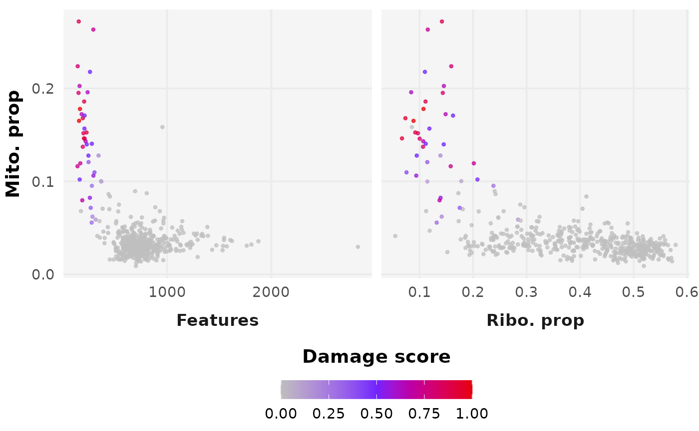

# DamageDetective Overview

## Package description

The goal of `DamageDetective` is to simplify the process of making
informed and reproducible damaged cell filtering decisions during the
pre-processing of single cell RNA sequencing data.

This requires only a count matrix to run and outputs a damage score
ranging from 0 (viable, intact cell) to 1 (broken, non-viable cell).
There is an option for automatic filtering using the default upper
threshold damage score of 0.5.

We will demonstrate briefly using an example dataset provided upon
package installation.

``` r

library(DamageDetective)
library(Matrix)
data("test_counts", package = "DamageDetective")
dim(test_counts)
#> [1] 32738   500
```

## Prerequisites

### Libraries

For an improvement in speed, load the `presto` package in addition to
`DamageDetective`.

``` r

install.packages("remotes")
remotes::install_github("madsen-lab/valiDrops")

library(DamageDetective)
library(presto)
```

### Input data formatting

- Counts should be provided in the form of a compressed, column-oriented
  sparse matrix (`dgCMatrix`) in `R`.

``` r

# View formatting
class(test_counts)
#> [1] "dgCMatrix"
#> attr(,"package")
#> [1] "Matrix"
```

- Counts should have gene sets formatted according to HGCN standard,
  i.e., `MT-...` rather than `ENSG...`.

``` r

# View formatting
head(rownames(test_counts))
#> [1] "MIR1302-10"   "FAM138A"      "OR4F5"        "RP11-34P13.7" "RP11-34P13.8"
#> [6] "AL627309.1"
```

    > See [biomaRt](https://bioconductor.org/packages/release/bioc/html/biomaRt.html) for conversion assistance or use the automated `Seurat` functions for working with alignment output, [ReadMtx](https://satijalab.org/seurat/reference/readmtx).

- `DamageDetective` supports data of human and mouse, specified using
  the `organism` parameter. To analyse a non-standard organism, provide
  a list with patterns that matches the set of mitochondrially encoded
  genes and ribosomal genes and genes with a confirmed, permanent
  nuclear residence.

> **Example using humans as organism of interest**
>
> ``` r
>
> organism = list(mito_pattern = "^MT-",
>                 ribo_pattern = "^(RPS|RPL)",
>                 nuclear = c("NEAT1","XIST", "MALAT1"))
> ```

For more information on data preparation, view the package articles on
our [website](https://alicenjoyhenning.github.io/DamageDetective)

### Parameter selection

#### `select_penalty`

While `detect_damage` requires only a count matrix as input, additional
parameters control aspects of the function’s computations. Of these, we
recommend `ribosome_penalty` be adjusted for each dataset using the
`select_penalty` function.

This parameter ranges from 0 to 1 and adjusts the likelihood of
ribosomal RNA loss during simulation, correcting for observed
discrepancies where ribosomal RNA is retained more than expected based
on transcript abundance.

``` r

penalty <- select_penalty(
  count_matrix = test_counts, 
  max_penalty_trials = 3 # Shortened for the vignette
)
#> Testing penalty of 0.1...
#> Testing penalty of 0.15...
#> Testing penalty of 0.2...
#> Maximum penalty trials reached (3). Stopping.
penalty
#> [1] 0.15
```

#### `filter_threshold`

`DamageDetective` offers the upper threshold 0.5 as the damage score
above which cells are filtered, where values greater than 0.5 reflect
more permissive filtering and values closer to 0 reflect more stringent
filtering. We recommend the default, but suggest that if adjustments are
made, they are informed by the output detect_damage plots, generate_plot
= TRUE.

For more information on parameters, please view the function
documentation available on our website under **References**.

## Running damaged cell detection

Damage detection is run using the count matrix and ribosomal penalty as
inputs. Below, we have additionally specified for `filter_counts`
parameter to be TRUE. This will use the default `filter_threshold` and
return the filtered count matrix that can be used immediately for the
remainder of pre-processing.

``` r

# Perform damage detection
detection_results <- detect_damage(
  count_matrix = test_counts,
  ribosome_penalty = penalty,
  display_plot = FALSE,
  filter_counts = TRUE
)
#> Clustering cells...
#> Checking clusters...
#> Simulating damage...
#> Computing pANN...
#>  ... 1 suggested threshold.
#> Completed.

# View the resulting count matrix
dim(detection_results$output)
#> [1] 32738   500

# View the plot 
detection_results$plot
```



## Session Information

    #> R version 4.6.2 (2026-10-29)
    #> Platform: x86_64-pc-linux-gnu
    #> Running under: Ubuntu 26.04.1 LTS
    #> 
    #> Matrix products: default
    #> BLAS:   /usr/lib/x86_64-linux-gnu/openblas-pthread/libblas.so.3 
    #> LAPACK: /usr/lib/x86_64-linux-gnu/openblas-pthread/libopenblasp-r0.3.32.so;  LAPACK version 3.12.0
    #> 
    #> locale:
    #>  [1] LC_CTYPE=C.UTF-8       LC_NUMERIC=C           LC_TIME=C.UTF-8       
    #>  [4] LC_COLLATE=C.UTF-8     LC_MONETARY=C.UTF-8    LC_MESSAGES=C.UTF-8   
    #>  [7] LC_PAPER=C.UTF-8       LC_NAME=C              LC_ADDRESS=C          
    #> [10] LC_TELEPHONE=C         LC_MEASUREMENT=C.UTF-8 LC_IDENTIFICATION=C   
    #> 
    #> time zone: UTC
    #> tzcode source: system (glibc)
    #> 
    #> attached base packages:
    #> [1] stats     graphics  grDevices utils     datasets  methods   base     
    #> 
    #> other attached packages:
    #> [1] Matrix_1.7-6           DamageDetective_2.0.15
    #> 
    #> loaded via a namespace (and not attached):
    #>   [1] tidyselect_1.2.1    dplyr_1.2.1         farver_2.1.2       
    #>   [4] S7_0.2.2            fastmap_1.2.0       RANN_2.6.3         
    #>   [7] digest_0.6.39       dotCall64_1.2       lifecycle_1.0.5    
    #>  [10] cluster_2.1.8.3     SeuratObject_5.4.0  magrittr_2.0.5     
    #>  [13] compiler_4.6.2      rlang_1.3.0         sass_0.4.10        
    #>  [16] tools_4.6.2         igraph_2.3.4        yaml_2.3.12        
    #>  [19] ggsignif_0.6.4      knitr_1.52          labeling_0.4.3     
    #>  [22] sp_2.2-4            plyr_1.8.9          RColorBrewer_1.1-3 
    #>  [25] abind_1.4-8         KernSmooth_2.23-27  Rtsne_0.17         
    #>  [28] withr_3.0.3         purrr_1.2.2         desc_1.4.3         
    #>  [31] grid_4.6.2          ggpubr_1.0.0        RcppHNSW_0.7.0     
    #>  [34] fastDummies_1.7.6   e1071_1.7-17        future_1.82.0      
    #>  [37] progressr_1.1.0     ggplot2_4.0.4       globals_0.20.0     
    #>  [40] scales_1.4.0        MASS_7.3-66         ggridges_0.5.7     
    #>  [43] cli_3.6.6           rmarkdown_2.32      ragg_1.5.2         
    #>  [46] generics_0.1.4      Seurat_6.0.0        otel_0.3.0         
    #>  [49] ica_1.0-3           future.apply_1.21.0 RSpectra_0.16-2    
    #>  [52] sctransform_0.4.3   httr_1.4.9          reshape2_1.4.5     
    #>  [55] pbapply_1.7-5       cachem_1.1.0        proxy_0.4-29       
    #>  [58] stringr_1.6.0       parallel_4.6.2      matrixStats_1.5.0  
    #>  [61] vctrs_0.7.3         carData_3.0-6       jsonlite_2.0.0     
    #>  [64] car_3.1-5           patchwork_1.3.2     rstatix_1.1.0      
    #>  [67] ggrepel_0.9.8       Formula_1.2-6       irlba_2.4.1        
    #>  [70] scattermore_1.2     listenv_1.1.0       systemfonts_1.3.3  
    #>  [73] tidyr_1.3.2         jquerylib_0.1.4     pls_2.9-0          
    #>  [76] glue_1.8.1          parallelly_1.50.0   spam_2.11-4        
    #>  [79] pkgdown_2.2.1       codetools_0.2-20    cowplot_1.2.0      
    #>  [82] uwot_0.2.5          RcppAnnoy_0.0.23    stringi_1.8.9      
    #>  [85] gtable_0.3.6        tibble_3.3.1        pillar_1.11.1      
    #>  [88] htmltools_0.5.9     R6_2.6.1            textshaping_1.0.5  
    #>  [91] evaluate_1.0.5      lattice_0.23-1      backports_1.5.1    
    #>  [94] png_0.1-9           broom_1.0.13        bslib_0.12.0       
    #>  [97] class_7.3-24        Rcpp_1.1.2          gridExtra_2.3.1    
    #> [100] xfun_0.62           fs_2.1.0            pkgconfig_2.0.3
