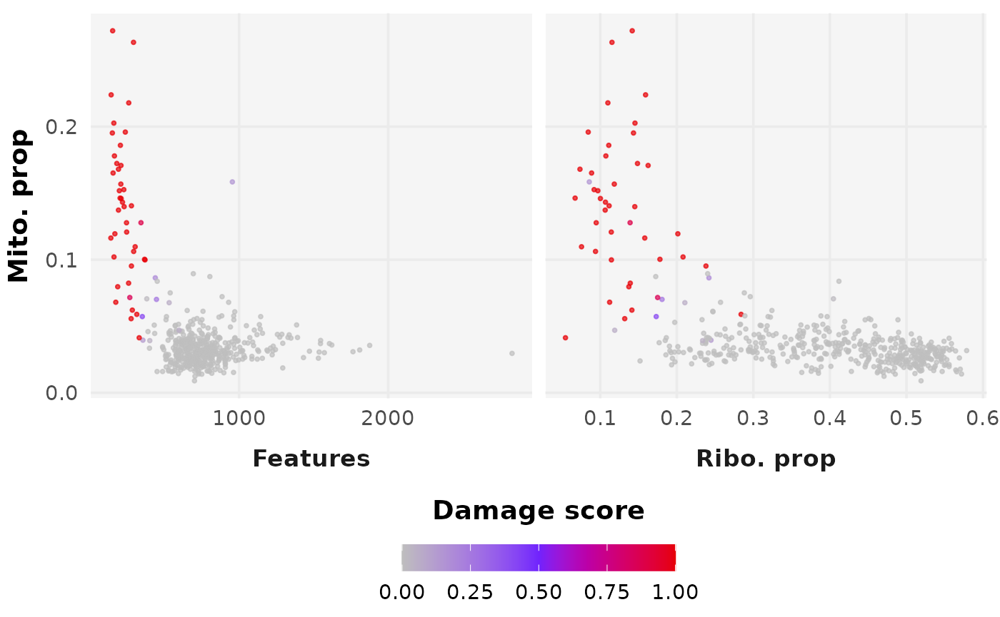

# DamageDetective Overview

## Package description

The goal of `DamageDetective` is to simplify the process of making
informed and reproducible damaged cell filtering decisions during the
pre-processing of single cell RNA sequencing data.

This requires only a count matrix to run and outputs a damage score
ranging from 0 (viable, intact cell) to 1 (broken, non-viable cell).
There is an option for automatic filtering using the default upper
threshold damage score of 0.5.

We will demonstrate briefly using an example dataset provided upon
package installation.

``` r

library(DamageDetective)
library(Matrix)
data("test_counts", package = "DamageDetective")
dim(test_counts)
#> [1] 32738   500
```

## Prerequisites

### Libraries

For an improvement in speed, load the `presto` package in addition to
`DamageDetective`.

``` r

install.packages("remotes")
remotes::install_github("madsen-lab/valiDrops")

library(DamageDetective)
library(presto)
```

### Input data formatting

- Counts should be provided in the form of a compressed, column-oriented
  sparse matrix (`dgCMatrix`) in `R`.

``` r

# View formatting
class(test_counts)
#> [1] "dgCMatrix"
#> attr(,"package")
#> [1] "Matrix"
```

- Counts should have gene sets formatted according to HGCN standard,
  i.e., `MT-...` rather than `ENSG...`.

``` r

# View formatting
head(rownames(test_counts))
#> [1] "MIR1302-10"   "FAM138A"      "OR4F5"        "RP11-34P13.7" "RP11-34P13.8"
#> [6] "AL627309.1"
```

    > See [biomaRt](https://bioconductor.org/packages/release/bioc/html/biomaRt.html) for conversion assistance or use the automated `Seurat` functions for working with alignment output, [ReadMtx](https://satijalab.org/seurat/reference/readmtx).

- `DamageDetective` supports data of human and mouse, specified using
  the `organism` parameter. To analyse a non-standard organism, provide
  a list with patterns that matches the set of mitochondrially encoded
  genes and ribosomal genes and genes with a confirmed, permanent
  nuclear residence.

> **Example using humans as organism of interest**
>
> ``` r
>
> organism = list(mito_pattern = "^MT-",
>                 ribo_pattern = "^(RPS|RPL)",
>                 nuclear = c("NEAT1","XIST", "MALAT1"))
> ```

For more information on data preparation, view the package articles on
our [website](https://alicenjoyhenning.github.io/DamageDetective)

### Parameter selection

#### `select_penalty`

While `detect_damage` requires only a count matrix as input, additional
parameters control aspects of the function’s computations. Of these, we
recommend `ribosome_penalty` be adjusted for each dataset using the
`select_penalty` function.

This parameter ranges from 0 to 1 and adjusts the likelihood of
ribosomal RNA loss during simulation, correcting for observed
discrepancies where ribosomal RNA is retained more than expected based
on transcript abundance.

``` r

penalty <- select_penalty(
  count_matrix = test_counts, 
  max_penalty_trials = 3 # Shortened for the vignette
)
#> Testing penalty of 0.1...
#> Testing penalty of 0.15...
#> Testing penalty of 0.2...
#> Maximum penalty trials reached (3). Stopping.
penalty
#> [1] 0.15
```

#### `filter_threshold`

`DamageDetective` offers the upper threshold 0.5 as the damage score
above which cells are filtered, where values greater than 0.5 reflect
more permissive filtering and values closer to 0 reflect more stringent
filtering. We recommend the default, but suggest that if adjustments are
made, they are informed by the output detect_damage plots, generate_plot
= TRUE.

For more information on parameters, please view the function
documentation available on our website under **References**.

## Running damaged cell detection

Damage detection is run using the count matrix and ribosomal penalty as
inputs. Below, we have additionally specified for `filter_counts`
parameter to be TRUE. This will use the default `filter_threshold` and
return the filtered count matrix that can be used immediately for the
remainder of pre-processing.

``` r

# Perform damage detection
detection_results <- detect_damage(
  count_matrix = test_counts,
  ribosome_penalty = penalty,
  display_plot = FALSE,
  filter_counts = TRUE
)
#> Clustering cells...
#> Checking clusters...
#> Simulating damage...
#> Computing pANN...
#> Warning in .finalise_output(metadata_plot, count_matrix, filter_counts, : No
#> pANN peaks detected.
#>  ... 0.5 suggested threshold.
#> Completed.

# View the resulting count matrix
dim(detection_results$output)
#> [1] 32738   458

# View the plot 
detection_results$plot
```



## Session Information

    #> R version 4.6.1 (2026-06-24)
    #> Platform: x86_64-pc-linux-gnu
    #> Running under: Ubuntu 24.04.5 LTS
    #> 
    #> Matrix products: default
    #> BLAS:   /usr/lib/x86_64-linux-gnu/openblas-pthread/libblas.so.3 
    #> LAPACK: /usr/lib/x86_64-linux-gnu/openblas-pthread/libopenblasp-r0.3.26.so;  LAPACK version 3.12.0
    #> 
    #> locale:
    #>  [1] LC_CTYPE=C.UTF-8       LC_NUMERIC=C           LC_TIME=C.UTF-8       
    #>  [4] LC_COLLATE=C.UTF-8     LC_MONETARY=C.UTF-8    LC_MESSAGES=C.UTF-8   
    #>  [7] LC_PAPER=C.UTF-8       LC_NAME=C              LC_ADDRESS=C          
    #> [10] LC_TELEPHONE=C         LC_MEASUREMENT=C.UTF-8 LC_IDENTIFICATION=C   
    #> 
    #> time zone: UTC
    #> tzcode source: system (glibc)
    #> 
    #> attached base packages:
    #> [1] stats     graphics  grDevices utils     datasets  methods   base     
    #> 
    #> other attached packages:
    #> [1] Matrix_1.7-5           DamageDetective_2.0.15
    #> 
    #> loaded via a namespace (and not attached):
    #>   [1] RColorBrewer_1.1-3     jsonlite_2.0.0         magrittr_2.0.5        
    #>   [4] spatstat.utils_3.2-5   farver_2.1.2           rmarkdown_2.32        
    #>   [7] fs_2.1.0               ragg_1.5.2             vctrs_0.7.3           
    #>  [10] ROCR_1.0-12            spatstat.explore_3.8-3 rstatix_1.1.0         
    #>  [13] htmltools_0.5.9        broom_1.0.13           Formula_1.2-6         
    #>  [16] sass_0.4.10            sctransform_0.4.3      parallelly_1.48.0     
    #>  [19] KernSmooth_2.23-26     bslib_0.12.0           htmlwidgets_1.6.4     
    #>  [22] desc_1.4.3             ica_1.0-3              plyr_1.8.9            
    #>  [25] plotly_4.12.1          zoo_1.9-1              cachem_1.1.0          
    #>  [28] igraph_2.3.4           mime_0.13              lifecycle_1.0.5       
    #>  [31] pkgconfig_2.0.3        R6_2.6.1               fastmap_1.2.0         
    #>  [34] fitdistrplus_1.2-6     future_1.76.0          shiny_1.14.0          
    #>  [37] digest_0.6.39          patchwork_1.3.2        Seurat_5.6.0          
    #>  [40] tensor_1.5.1           RSpectra_0.16-2        irlba_2.4.1           
    #>  [43] textshaping_1.0.5      ggpubr_1.0.0           labeling_0.4.3        
    #>  [46] progressr_1.0.0        spatstat.sparse_3.2-0  httr_1.4.9            
    #>  [49] polyclip_1.10-7        abind_1.4-8            compiler_4.6.1        
    #>  [52] proxy_0.4-29           withr_3.0.3            S7_0.2.2              
    #>  [55] backports_1.5.1        carData_3.0-6          fastDummies_1.7.6     
    #>  [58] ggsignif_0.6.4         MASS_7.3-65            tools_4.6.1           
    #>  [61] lmtest_0.9-40          otel_0.2.0             httpuv_1.6.17         
    #>  [64] future.apply_1.20.2    goftest_1.2-3          glue_1.8.1            
    #>  [67] nlme_3.1-169           promises_1.5.0         grid_4.6.1            
    #>  [70] Rtsne_0.17             cluster_2.1.8.2        reshape2_1.4.5        
    #>  [73] generics_0.1.4         gtable_0.3.6           spatstat.data_3.1-9   
    #>  [76] class_7.3-23           tidyr_1.3.2            data.table_1.18.6.1   
    #>  [79] sp_2.2-4               car_3.1-5              spatstat.geom_3.8-3   
    #>  [82] RcppAnnoy_0.0.23       ggrepel_0.9.8          RANN_2.6.3            
    #>  [85] pillar_1.11.1          stringr_1.6.0          spam_2.11-4           
    #>  [88] RcppHNSW_0.7.0         later_1.4.8            splines_4.6.1         
    #>  [91] dplyr_1.2.1            lattice_0.22-9         survival_3.8-6        
    #>  [94] deldir_2.0-4           tidyselect_1.2.1       miniUI_0.1.2          
    #>  [97] pbapply_1.7-5          knitr_1.52             gridExtra_2.3.1       
    #> [100] scattermore_1.2        xfun_0.61              matrixStats_1.5.0     
    #> [103] stringi_1.8.9          yaml_2.3.12            evaluate_1.0.5        
    #> [106] codetools_0.2-20       tibble_3.3.1           cli_3.6.6             
    #> [109] uwot_0.2.5             xtable_1.8-8           reticulate_1.47.0     
    #> [112] systemfonts_1.3.2      jquerylib_0.1.4        Rcpp_1.1.2            
    #> [115] globals_0.20.0         spatstat.random_3.5-2  png_0.1-9             
    #> [118] spatstat.univar_3.2-0  parallel_4.6.1         pkgdown_2.2.1         
    #> [121] ggplot2_4.0.3          dotCall64_1.2          listenv_1.1.0         
    #> [124] viridisLite_0.4.3      scales_1.4.0           ggridges_0.5.7        
    #> [127] e1071_1.7-17           SeuratObject_5.4.0     purrr_1.2.2           
    #> [130] rlang_1.3.0            cowplot_1.2.0
